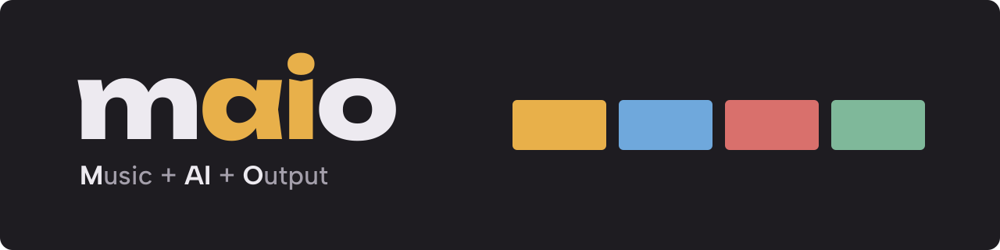
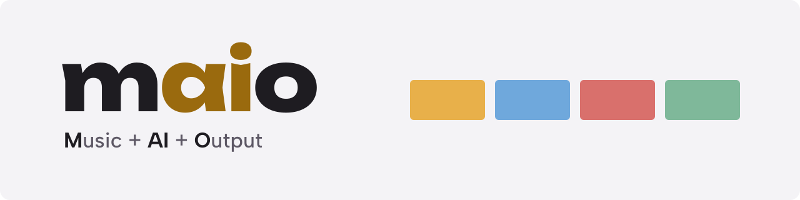

# Design

The look of Maio's web app, in the [DESIGN.md format](https://github.com/google-labs-code/design.md/blob/main/docs/spec.md). The YAML blocks are the tokens; `style/main.css` implements them, and a test fails when the two disagree. What each screen does is in [arc42 8.5](docs/architecture/08-crosscutting-concepts.md#85-the-web-app); the accessibility rules are in [arc42 10](docs/architecture/10-quality-requirements.md).

## Overview

Shelf is dark and warm, with one accent colour (mustard) and a colour per playlist. Playlists are coloured tiles on a shelf above the songs, and each keeps its colour everywhere it appears. Actions are icons with captions rather than words. It is one person's tool, so screens are dense and have no onboarding or decoration; everything works with a keyboard and from 360 px wide.

## Colors

Dark by default, with a light theme; a sun/moon switch in the header changes it, remembered on the device. Tokens ending in `-light` are the light theme's values; the rest are dark, or the same in both.

- **Mustard (#E8B04A)** is the primary colour: the Make button, the primary button, the player bar and focus. On the light theme, focus and links use a darker **Ochre (#9A6A0E)** to keep their contrast.
- **Night (#1E1C21)** is the page, and the text on every coloured surface; **Panel (#28252C)** lifts cards, menus and dialogs off it.
- **Ink (#EDEAF0)** is text; **Muted (#A49FAB)** is secondary text, still above 4.5:1; **Faint (#6E6875)** is decoration only, never text.
- **Live red (#B3261E)** marks what is on air; text on it is white.
- Each playlist takes the next colour in turn: mustard, **Blue (#6FA8DC)**, **Rose (#D9706C)**, **Sage (#7FB89A)**, then repeating. It is used for the playlist's shelf tile, its page band and the marks on its songs.

```yaml
colors:
  primary: "#E8B04A"
  bg: "#1E1C21"
  panel: "#28252C"
  ink: "#EDEAF0"
  muted: "#A49FAB"
  faint: "#6E6875"
  line: "#332F38"
  line2: "#4A4552"
  accent: "#E8B04A"
  sel: "#332F38"
  mustard: "#E8B04A"
  on-colour: "#1E1C21"
  live: "#B3261E"
  on-live: "#FFFFFF"
  bg-light: "#F4F3F6"
  panel-light: "#FFFFFF"
  ink-light: "#1E1C21"
  muted-light: "#5D5865"
  faint-light: "#9C97A4"
  line-light: "#E4E2E8"
  line2-light: "#C8C4CE"
  accent-light: "#9A6A0E"
  sel-light: "#FBF1DE"
  playlist-1: "#E8B04A"
  playlist-2: "#6FA8DC"
  playlist-3: "#D9706C"
  playlist-4: "#7FB89A"
```

## Typography

**Unbounded**, wide and heavy, sets the page headings, the logo and the song playing; **Albert Sans** sets everything else. Both are served from `public/fonts`. Headings are tight (letter spacing -0.02em, -0.03em on a playlist's band); buttons and labels are bold.

```yaml
typography:
  headline-display:
    fontFamily: Unbounded
    fontSize: 56px
    fontWeight: 800
    lineHeight: 1
    letterSpacing: -0.03em
  headline-lg:
    fontFamily: Unbounded
    fontSize: 34px
    fontWeight: 800
    letterSpacing: -0.02em
  headline-md:
    fontFamily: Unbounded
    fontSize: 20px
    fontWeight: 700
    letterSpacing: -0.02em
  logo:
    fontFamily: Unbounded
    fontSize: 22px
    fontWeight: 800
    letterSpacing: -0.02em
  body-md:
    fontFamily: Albert Sans
    fontSize: 16px
    fontWeight: 400
    lineHeight: 1.45
  label-md:
    fontFamily: Albert Sans
    fontSize: 14px
    fontWeight: 700
  label-sm:
    fontFamily: Albert Sans
    fontSize: 13px
    fontWeight: 700
```

The playlist band's name scales from 32 px on a phone to `headline-display` on a wide screen.

## Layout

One column with a 44 px gutter, 16 px at 720 px wide and less. The shelf is a single row that never scrolls: as many tiles as fit, at most five. Every target is at least 44 px.

```yaml
spacing:
  gutter: 44px
  gutter-phone: 16px
  target: 44px
  gap: 16px
  band: 28px
```

## Elevation & Depth

Mostly flat: depth comes from tone, a panel one step lighter than the page, with 1 px lines between rows. Only what floats over the page casts a soft shadow: the engine and MediaMTX panels, menus and dialogs. Motion is short and stops when the system asks for reduced motion.

## Shapes

Soft rectangles and full rounds. Tiles and rows have 6 px corners; cards, bands and the large buttons 8 px; icon buttons, tabs, chips and switches are fully round.

```yaml
rounded:
  sm: 6px
  md: 8px
  full: 9999px
```

## Components

- **Icon buttons** for actions (play, shuffle, add, more, live, lock, refresh, copy, cancel, remove), each with a tooltip and an accessible label.
- **The favicon** (`public/favicon.svg`): the wordmark's "ai", mustard strokes on a night rounded square, so it reads on light and dark tabs.

  
- **The banner** (`docs/images/banner-dark.svg`, `docs/images/banner-light.svg`): the top of the README. The wordmark, "ai" in the accent, over the tagline "Music + AI + Output" (its M, AI and O in ink, the rest muted), and the shelf's four playlist colours as tiles. Dark on Night with Mustard, light on bg-light with Ochre; the README picks one by `prefers-color-scheme`. The letters are outlines, Unbounded at 800 and Albert Sans, because GitHub shows README pictures with no fonts.

  

  
- **The social preview** (`docs/images/social-preview.png`, 1280×640): the dark banner as a card, for shared links. The documentation site names it as every page's link preview, and it is the repository's social preview on GitHub.

- **Status icons** in the header: the engine (a chip) and MediaMTX (a broadcast mark), each with a 9 px status dot on its corner, green when all is well, ringed in the page colour; the state is the caption, never words on the bar.
- **Tiles** on the shelf, in the playlist's colour (the tokens show the second playlist's).
- **The band** heads a playlist page: its colour (the tokens show the third playlist's), its name and length, and solid round icon buttons.
- **Chips** hold a song's settings (mood, genre) and the stream addresses with their copy buttons. A song's tempo and length are chips too, each holding a slider in the accent colour with its value beside it; on a phone each takes a row of its own. The tempo slider is dimmed while it is on Auto, with "Auto" in place of the value, and a small reset button at the chip's end, hidden on Auto, brings it back there.
- **Dialogs** are the browser's own `<dialog>`; the engine and MediaMTX panels use the popover API ([ADR 0010](docs/adr/0010-native-browser-features-first.md)). Toasts also go to a hidden `role="status"` region.

```yaml
components:
  button-primary:
    backgroundColor: "{colors.mustard}"
    textColor: "{colors.on-colour}"
    typography: "{typography.label-md}"
    rounded: "{rounded.md}"
    height: 44px
    padding: 22px
  button-make:
    backgroundColor: "{colors.mustard}"
    textColor: "{colors.on-colour}"
    typography: "{typography.label-sm}"
    rounded: "{rounded.md}"
    size: 84px
  icon-button:
    textColor: "{colors.ink}"
    rounded: "{rounded.full}"
    size: 44px
  icon-button-player:
    rounded: "{rounded.full}"
    size: 50px
  tile:
    backgroundColor: "{colors.playlist-2}"
    textColor: "{colors.on-colour}"
    rounded: "{rounded.sm}"
    width: 200px
    height: 104px
    padding: 14px
  band:
    backgroundColor: "{colors.playlist-3}"
    textColor: "{colors.on-colour}"
    typography: "{typography.headline-display}"
    rounded: "{rounded.md}"
    padding: 28px
  chip:
    textColor: "{colors.ink}"
    typography: "{typography.label-md}"
    rounded: "{rounded.full}"
    height: 44px
    padding: 12px
  tab:
    textColor: "{colors.ink}"
    rounded: "{rounded.full}"
    height: 38px
    padding: 18px
  live-switch:
    textColor: "{colors.ink}"
    rounded: "{rounded.full}"
    height: 44px
    padding: 16px
  live-switch-on:
    backgroundColor: "{colors.live}"
    textColor: "{colors.on-live}"
    rounded: "{rounded.full}"
    height: 44px
    padding: 16px
  card:
    backgroundColor: "{colors.panel}"
    rounded: "{rounded.md}"
    padding: 28px
```

## Do's and Don'ts

- Do give a playlist the same colour everywhere: tile, band and song marks.
- Do put text on a coloured surface in `on-colour`, never white; live red is the one exception, with `on-live`.
- Do use an icon with a tooltip and an accessible label for an action; don't add a visible word unless the icon is ambiguous.
- Do keep text at 4.5:1 or more in both themes; don't set text in `faint`.
- Don't use mustard for anything that is not the main action, the player or focus.
- Don't scroll the shelf sideways; show an "All playlists" tile instead.
- Do use the browser's `<dialog>` and popover; don't build a custom modal.
