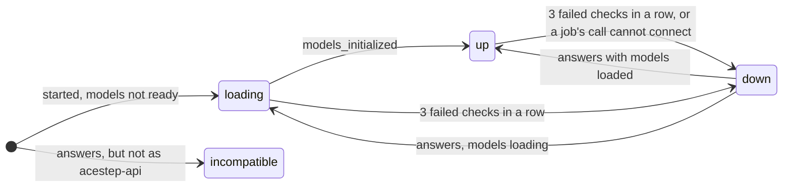

# 3. System scope and context

## 3.1 Business context

| Partner | Exchanges with Maio |
|---------|--------------------------|
| You, in a browser | Sign in, make songs, manage the library and playlists, play, go live, watch engines and MediaMTX. |
| Scripts | The same, through the JSON API with the API token (3.5). |
| Listeners | Pull a live playlist over MP3, AAC, HLS (from Maio) or RTSP, SRT, RTMP (from MediaMTX), with no account. |
| ACE-Step 1.5 | Makes the music, and can write lyrics (3.3). |
| Text engines | Write lyrics, titles and descriptions (3.4). |
| MediaMTX | Relays live playlists over RTSP, SRT and RTMP, asks Maio who may read or publish, reports its state. |

## 3.2 Technical context: the shape

- Maio is one container: one binary plus ffmpeg, one config file (`maio.toml`), one data volume. MediaMTX runs beside it in the same compose file.
- Engine servers are separate programs Maio neither starts nor supervises. ACE-Step runs as its own server on the machine with the GPU, started as [Run ACE-Step for Maio](../how-to/01-run-ace-step-for-maio.md) says.
- Port 8080 serves the web app, the JSON API and the live streams.

Drawn from the C4 model; open it to inspect each element:

```c4
context
```

Inside Maio, the containers:

```c4
containers
```

## 3.3 The music engine: ACE-Step 1.5

Maio makes music with ACE-Step 1.5, through ACE-Step's own HTTP server, `acestep-api`, run on the machine with the GPU and set up as [ACE-Step's own instructions](https://github.com/ace-step/ACE-Step-1.5#readme) say. The settings Maio expects (port 7801, the models loaded at start, the planning model) are in [Run ACE-Step for Maio](../how-to/01-run-ace-step-for-maio.md); bound to `127.0.0.1`, only that machine and its containers reach it. See [ADR 0006](../adr/0006-ace-steps-own-api.md).

```toml
[[engine]]
id = "ace-step"
url = "http://host.docker.internal:7801"
# api_key_env = "ACE_STEP_API_KEY"
```

ACE-Step can require an API key (its `ACESTEP_API_KEY`). `api_key_env` names the variable that holds it; Maio then sends it as `Authorization: Bearer <key>` on every call, and a missing variable stops the start. ACE-Step is started with the same key as its `ACESTEP_API_KEY`. The key never appears in logs.

| Maio needs | `acestep-api` call |
|-----------------|--------------------|
| health, loaded models | `GET /health` (`models_initialized`, `loaded_model`, `loaded_lm_model`) |
| queue | `GET /v1/stats` |
| installed models | `GET /v1/model_inventory` |
| make a song | `POST /release_task`: prompt, lyrics (`[Instrumental]` for none), duration, bpm, seed with `use_random_seed: false`, `batch_size: 1`, `audio_format: "wav"` |
| status, lyrics, bpm, key, time signature | `POST /query_result` |
| the audio | `GET /v1/audio?path=…` (the path `query_result` names) |
| lyrics written by ACE-Step | `POST /v1/create_sample` before `release_task` |
| switch model | `POST /v1/init` (the engine panel, arc42 8.5) |

Lifecycle:



- Health: checked at start and every 10 s, every 5 s after a failed check or while `down`. `up` when the models are initialised, `loading` before, `down` at once when nothing listens at its address, after 3 checks in a row that get no answer in time, or at once when a call made for a job cannot connect (so new songs are refused with `engine_unavailable` instead of starting jobs that cannot run), `incompatible` when the URL answers but not as `acestep-api`.
- A running job is polled every `engine_poll_s` (2 s by default). Progress and stage come from ACE-Step (`query_result`); a song waiting in ACE-Step's own queue shows as waiting. An id ACE-Step answers with an empty result (lost in a restart) fails the job as lost, and it is tried once more on another engine when there is one.
- When ACE-Step is busy, slow or gone, the health state works as a circuit breaker, and busy answers and failed polls are retried with exponential backoff: [arc42 8.8](08-crosscutting-concepts.md#88-when-the-engine-is-busy-or-down) has the rules and how they behave.
- ACE-Step can neither cancel nor delete a task. Cancelling a song being made stops Maio waiting for it; ACE-Step finishes it, nobody fetches it, and ACE-Step's own cleanup removes the file.
- A song with no change for `engine_stall_s` fails, and is tried once more on another engine when there is one.

Measured on an M3 Max (64 GB), ACE-Step 1.5 turbo: 9.4 GB of checkpoints, 92 s first model load including the download, a 60 s song in about 12 s warm (realtime factor about 0.2; 0.5 cold), WAV at 48 kHz stereo.

## 3.4 Text engines

Lyrics, titles and descriptions come from text engines: language models that write words, never music. Like music engines they are listed in config.

| Kind | Talks to | Notes |
|------|----------|-------|
| `ace-step` | ACE-Step's planning model, inside the music job | lyrics only; available wherever an ACE-Step engine is |
| `anthropic` | the Anthropic Messages API | needs an API key |
| `openai` | any OpenAI-compatible chat API (llama.cpp, Ollama, LM Studio, vLLM) | key optional |

- A text engine has an `id`, a `kind`, a `model`, a `url` (required for `openai`; `anthropic` defaults to Anthropic's API) and an optional `api_key_env`.
- Maio sends only your prompt, the structured fields and the lyrics, with fixed instructions. Reasoning text (`<think>…</think>`) in replies is dropped.
- Health: a one-token call at start and every 5 minutes.

## 3.5 The HTTP API

**Everything the web app does, the API does too**: the web app has no private calls, so a script with the API token can make songs, build playlists, go live and change anything you can ([ADR 0004](../adr/0004-the-web-app-uses-only-the-public-api.md)). All paths sit under `/api/v1` and need the session cookie or the API token (arc42 8.1); bodies are JSON; errors look like `{"error": {"code": "song_in_playlist", "message": "...", "playlists": [...]}}` with a matching status.

| Method | Path | Notes |
|--------|------|-------|
| POST | `/session` | `{"username","password","remember"}`; `204` and the cookie |
| DELETE | `/session` | sign out |
| POST | `/me/password` | `{"current","new"}` |
| GET | `/status` | engines (music and text) with health, live playlists, MediaMTX (`relay`, null without one), disk usage, moods and genres |
| PUT | `/engines/{id}/model` | `{"model"}`: load another installed model (ACE-Step's `/v1/init`); `204` |
| GET | `/events` | server-sent events, each carrying the new state as the API would answer it: `job` (the job); `song` (`{"id", "deleted", "song"}`: the song with its playlist marks); `playlist` (`{"id", "deleted", "summary", "view"}`, and a `song` event for each song whose marks changed); `live` (`{"id", "deleted", "live"}`: as `GET /playlists/{id}/live`, sent when it or another playlist goes on or off air, since it carries how many streams are in use, and when its song on air, its next song or its listeners change); `engine` (`{"id", "engine"}`, when its health, model or queue changes); `relay` (`{"relay"}`, when MediaMTX or what it carries changes). One task builds and tells every event, one at a time, so the newest state is always told last; a browser too far behind is disconnected, so it reconnects and loads again. The web app takes each event as the new state and never polls (arc42 8.5). |
| POST | `/songs` | a song request (arc42 8.2); `202 {"job_id", "eta_s"}` |
| GET | `/jobs` | jobs waiting or making |
| DELETE | `/jobs/{id}` | cancel |
| GET | `/songs?q=&sort=newest\|title&limit=&cursor=` | search covers titles, prompts, moods, genres and lyrics; each song lists the playlists it is in |
| GET | `/songs/{id}` | one song |
| PATCH | `/songs/{id}` | `{"title"}`; `title_source = "person"`, tags rewritten |
| DELETE | `/songs/{id}` | only when in no playlist |
| GET | `/songs/{id}/audio` | the file, with range requests |
| GET | `/songs/{id}/download?format=` | `mp3`, `aac`, `flac`, `wav` or `opus`: the song with its tags, as an attachment named after its title; the stored format is sent as it is |
| GET | `/playlists` | all playlists with song counts, length and live state |
| POST | `/playlists` | `{"name"}` |
| GET | `/playlists/{id}` | the playlist and its songs in order |
| PATCH | `/playlists/{id}` | `{"name"}` |
| DELETE | `/playlists/{id}` | not while live |
| POST | `/playlists/{id}/songs` | `{"song_ids": [...], "position"?}` |
| PUT | `/playlists/{id}/songs` | `{"song_ids": [...]}`, the whole new order |
| DELETE | `/playlists/{id}/songs/{song_id}` | remove from this playlist only |
| PUT | `/playlists/{id}/live` | `{"live": bool, "shuffle"?: bool, "visibility"?: "public"\|"private"}` |
| GET | `/playlists/{id}/live` | live state, now playing, next, listeners, addresses |
| POST | `/playlists/{id}/live/key` | a new private key |

Stream and relay paths (`/live/…`, `/listen/…`, `/relay/auth`) sit outside `/api/v1` and need no session (arc42 8.4).
