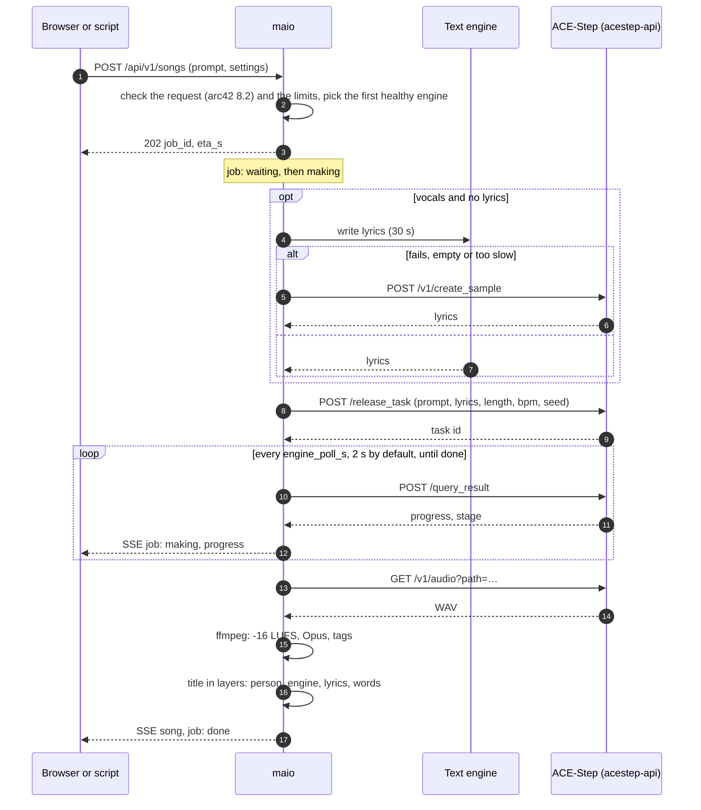
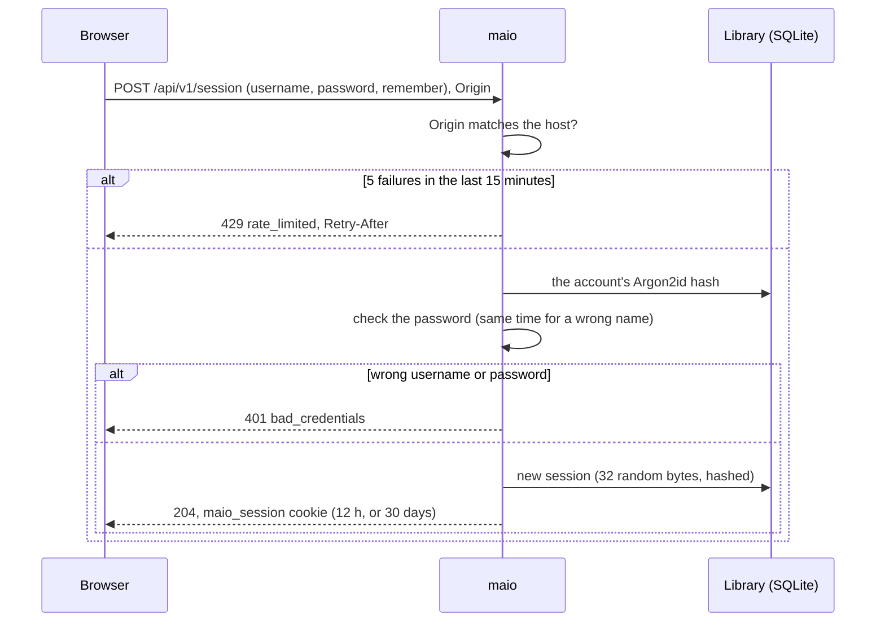
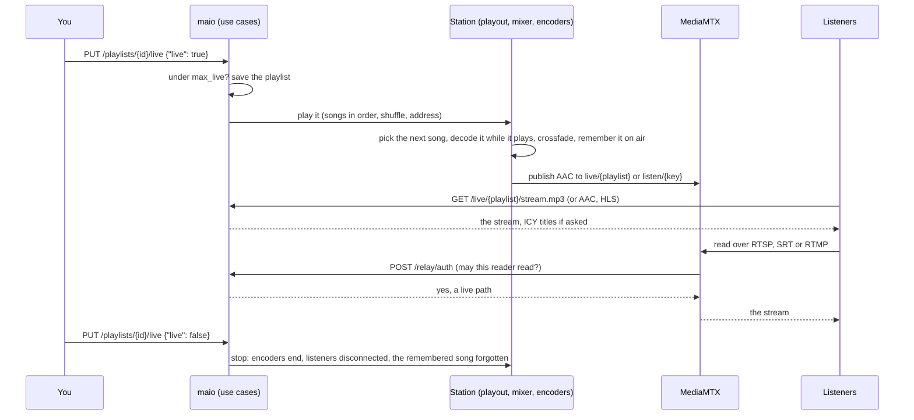
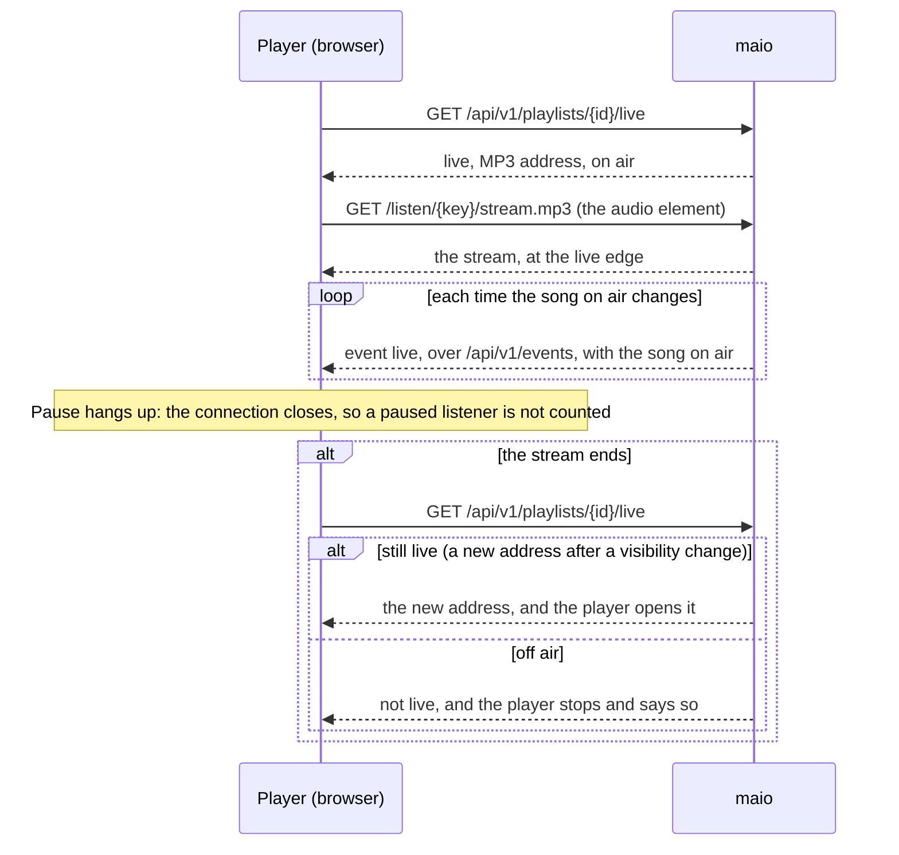
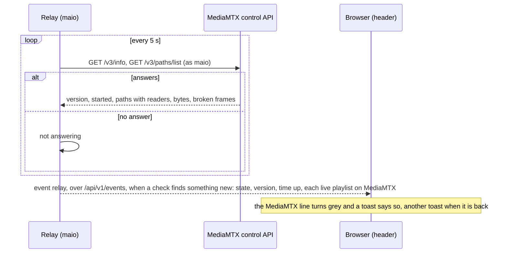

# 6. Runtime view

## 6.1 Making a song

- Jobs run one at a time per engine slot, in the order asked; a waiting or making job can be cancelled (ACE-Step finishes it; nobody fetches it).
- A lost task (ACE-Step answers an empty result) or a stall (`engine_stall_s`) fails the job, which is tried once more on another engine when there is one.
- The whole job is one `job` span under the request's span; ACE-Step's spans join through `traceparent` (arc42 8.6).

## 6.2 Signing in

A script sends `Authorization: Bearer <MAIO_API_TOKEN>` with each call instead: no session and no `Origin` check (arc42 8.1).

## 6.3 Going live and playing out

- An edit to the playlist reaches the station at once; a new key or a visibility change ends open streams and kicks MediaMTX's readers of the old path.
- After a restart, every playlist that was live comes back on air, starting with the song that was on air.

## 6.4 Listening live in the player

## 6.5 Watching MediaMTX

The password Maio uses with MediaMTX is made up at each start; MediaMTX checks it through the same auth hook (arc42 8.1).
