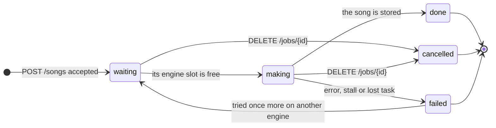
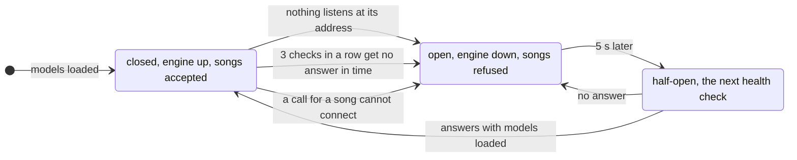
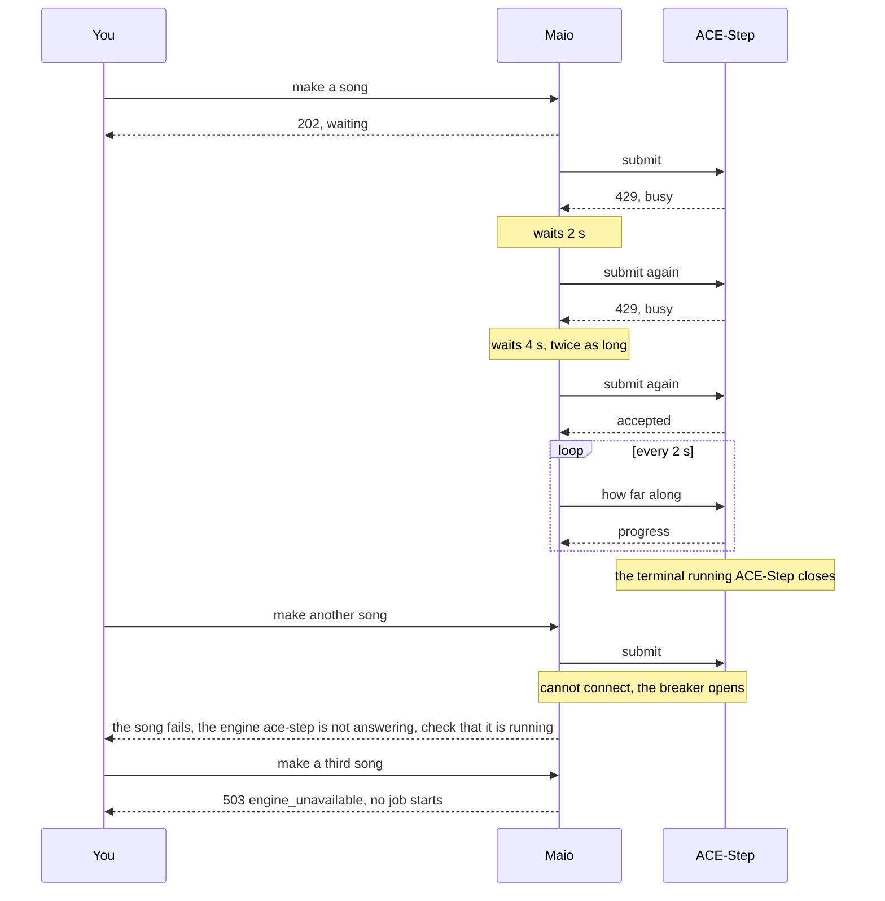

# 8. Crosscutting concepts

## 8.1 Signing in and security

There is one account, created on first start from `MAIO_ADMIN_USER` and `MAIO_ADMIN_PASSWORD`; without them Maio refuses to start, so it is never open. That account can do everything. There are no roles, no user management and no sign-up ([ADR 0005](../adr/0005-one-account-sessions-and-an-api-token.md)).

- Passwords are 10 to 128 characters, stored as Argon2id hashes, never logged or returned. The password is changed in the web app (current and new password); changing it ends all other sessions.
- Signing in creates a server-side session: 32 random bytes in the cookie `maio_session` (`HttpOnly`, `SameSite=Strict`, `Path=/`, `Secure` when `secure_cookies = true`). A session lasts 12 hours, or 30 days with "keep me signed in".
- Any state-changing request authenticated by cookie must carry an `Origin` header matching the host Maio is served on, else `403 bad_origin`.
- Sign-in limits: 5 failed attempts per 15 minutes; beyond that `429` with `Retry-After`. A wrong username and a wrong password take the same time and get the same `401 bad_credentials`.
- **API token** for scripts and other programs: `MAIO_API_TOKEN` (at least 32 characters) in `.env`. A request with `Authorization: Bearer <token>` acts as you, with no session and no `Origin` check. Without the variable, the API answers only the session cookie. The token is compared in constant time and never logged.
- Live streams need no account: anyone with a live playlist's address can listen (8.4). MediaMTX's own calls are decided by Maio's auth hook: Maio may publish and use the API with a password made up at each start; anyone may read a live path.
- Secrets (passwords, the API token, session ids, API keys, request headers) never appear in logs (8.6).

## 8.2 Songs

### Making a song

A song is asked for with a prompt and optional settings:

| Field | Type | Default | Rules |
|-------|------|---------|-------|
| `prompt` | string | none | what it sounds like, at most 500 characters |
| `mood` | string | none | one of the moods in config |
| `genre` | string | none | one of the genres in config |
| `energy` | string | none | `low`, `medium` or `high` |
| `seconds` | int | 180 | 15 to 600 |
| `tempo` | string or int | none | `slow`, `medium`, `fast`, or a BPM from 40 to 220 |
| `vocals` | bool | `false` | songs are instrumental unless asked |
| `lyrics` | string | none | only with `vocals`; `[verse]` and `[chorus]` sections |
| `vocal_language` | string | `[lyrics] default_language` | a language code such as `en` |
| `lyrics_by` | string | `[lyrics] default_engine` | `"ace-step"` or a text engine id; used when `lyrics` is empty |
| `engine` | string | automatic | a music engine id |
| `seed` | int | random | the same seed and settings make the same song |
| `allow_noncommercial` | bool | `false` | allows engines whose licence says `commercial: "no"` |

A request needs `prompt`, `mood`, or both. Maio turns mood, genre, energy and tempo into the engine prompt through a template, picks the first healthy engine in config order that can meet the request (unless `engine` names one; one that cannot meet it gets `422`), and starts a job (arc42 6.1).

- A job is `waiting`, `making` (with `progress` 0 to 1 and `eta_s`), `done` (with the new song's id), `failed` (with a reason) or `cancelled`. Jobs run one at a time per engine slot, in the order asked. You can cancel a job that is waiting or making.
- A failed job's reason is written for a person, naming the engine and what to do: "the engine ace-step is not answering at host.docker.internal:7801; check that it is running, then make the song again" when nothing answers at its address; "the engine ace-step failed: …" with the cause (no answer in time, an answer Maio does not understand, the status it answered) otherwise. Which call failed goes to the log.
- With `vocals` and no `lyrics`: the lyrics come from `lyrics_by`. A text engine is asked first (30 s limit); if it fails, answers empty or times out, ACE-Step writes them (`/v1/create_sample`, arc42 3.3), and the job notes the fallback.
- Licences: an engine marked `commercial: "no"` is used only with `allow_noncommercial`; otherwise `409 noncommercial_engine`, and the web app asks before resending. An engine marked `"limited"` is allowed, and its licence note travels with the job and the song.
- Rate limits (`[limits]`): `make` (default `20/10m`) and `pending_jobs` (default 4). Over a limit: `429 rate_limited` with `Retry-After`.

### What a song carries

Each song is stored as `songs/{id}.<ext>` in the storage format (`opus` by default; `flac`, `mp3`, `aac`), loudness-normalised to -16 LUFS on import ([ADR 0008](../adr/0008-songs-are-kept-opus-by-default.md)), plus a row with:

| Field | Source |
|-------|--------|
| `title`, `title_source` | titles in layers, below |
| `prompt`, `mood`, `genre`, `energy`, `seconds`, `bpm`, `seed`, `vocals` | the request and the engine |
| `key`, `time_signature` | reported by the engine when it knows them |
| `lyrics`, `vocal_language` | the words actually sung |
| `description` | one line, when a text engine named the song |
| `engine`, `licence`, `lyrics_engine`, `title_engine` | credits and licence terms |
| `artist` | `"Maio"` |
| `created_at`, `bytes` | |

Titles, in layers; each applies only when the one above gives nothing:

1. **You** renamed it: `title_source = "person"`, never overwritten.
2. **A text engine**, when `[naming] engine` names one: it gets the structured fields, your prompt and the lyrics, and returns a title of at most 60 characters and a one-line description (15 s limit). `title_source = "engine"`.
3. **The lyrics**: the first line of the first `[chorus]`, else the first lyric line, in title case, at most 60 characters. `title_source = "lyrics"`.
4. **Word lists** per mood and genre, picked by the seed ("Low Tide Static"); a title the library already has moves to the next seed. `title_source = "words"`.

Files carry tags: title, artist, genre, BPM, lyrics, and a comment with the engine, seed and licence. A rename rewrites the tags without re-encoding. A download in another format (MP3, AAC, FLAC, WAV, Opus) is converted with its tags; the stored format is sent as it is.

## 8.3 Playlists and the player

- A playlist has an `id`, a `name`, its songs in order, and its live settings (8.4).
- You create, rename and delete playlists, add songs (at a position, default the end; songs already in it are skipped), remove songs, and set the whole order.
- The player runs in the browser. It plays one song or a playlist from any song, with play and pause, previous and next, a seek bar, volume, shuffle, and repeat (off, all, one). Songs stream from `GET /api/v1/songs/{id}/audio` with HTTP range requests. The player is per browser and changes nothing on the server.
- Play on a live playlist (its band, its row on Playlists) tunes into its live stream (MP3), so you hear what its listeners hear ([ADR 0011](../adr/0011-a-live-playlist-plays-its-stream-in-the-player.md)): the bar shows Live, the song on air (looked up every 5 s) and the playlist; seek, previous, next, shuffle and repeat are off, since a broadcast plays the same for everyone (the stream's shuffle is in the live strip). Pause hangs up; Play again joins at the live edge. A song's own Play, and any playlist that is not live, play on demand. When the stream goes off air the player stops and says so.

## 8.4 Live

A playlist goes live with a switch. While live:

- Maio plays the playlist on the server, looping, with a fixed equal-power crossfade (default 6 s) ([ADR 0007](../adr/0007-live-playout-on-the-server-mediamtx-as-relay.md)). With **shuffle** on (a setting of the live playlist) it plays every song once in random order, then reshuffles; with shuffle off it plays the playlist's order. A song added while live joins the loop; a removed song leaves it after it finishes playing. The song shown as next was picked when the current one started; a new order applies from the song after it.
- Everyone who tunes in hears the same song at the same moment. An empty live playlist streams silence.
- After a restart a live playlist comes back on air with the song that was playing, from its start; taken off air, it starts from the top the next time.
- **Addresses** need no account and play in any player:
  - public: `/live/{playlist}/stream.mp3`, `/live/{playlist}/stream.aac`, `/live/{playlist}/hls/index.m3u8`;
  - private: `/listen/{key}/…` with the same files, where `key` is 32 random URL-safe characters; the public paths answer `404`. A new key stops the old one at once and disconnects its listeners. Switching between public and private also disconnects current listeners.
  - RTSP, SRT and RTMP through MediaMTX (`[relay]`) at `live/{playlist}` or `listen/{key}`; MediaMTX asks Maio at `POST /relay/auth` who may read or publish. Audio is AAC, since RTMP needs it and MediaMTX does not transcode. RTSP is TCP only.
- MP3 and AAC listeners that send `Icy-MetaData: 1` get `StreamTitle='Title - Maio'` every 16 000 bytes.
- The playlist page shows the live state, listener count (HTTP listeners plus relay readers), what plays now and next, and the addresses with copy buttons.
- Going live is refused beyond `max_live`; taking a playlist off air stops its encoders and disconnects its listeners.
- Maio asks MediaMTX's control API every 5 s how it is: its version, how long it has run, and for each live playlist whether its audio arrives (and since when), its format, its readers by RTSP, SRT and RTMP, the data sent and broken frames. No answer is "not answering" (arc42 6.5).

## 8.5 The web app

The design is called **Shelf**: playlists as coloured tiles on a shelf above the songs. Its look (colours in both themes, type, shape, components) is in [Design](../../DESIGN.md); this section is what each screen does.

- **Header**: the logo, the Songs and Playlists tabs, the engine icon (a chip with a status dot, green when a song can be made; its caption and name say which engine and how it is, as "ACE-Step 1.5 ready"; a click opens the engine panel: each engine's state and what to do about it, its version, model, lyrics model, queue, song lengths, voice, speed and licence, and a model switch when more than one model is installed), the MediaMTX icon when a relay is set up (a broadcast mark with a status dot, green when MediaMTX answers and every live playlist reaches it, its state in its caption and name; a click opens its panel: state and what to do about it, version, time up, its addresses, and each live playlist on it; a toast when it stops answering or a stream stops arriving, and when it is back), the theme switch, and an account menu with "Change password" and "Sign out". Both icons hide on phones.
- **Playlists** screen: a "New playlist" button and every playlist as a row like the song list's, in the shelf's order: play, its colour (as on its banner) and name (opens its page), its songs, the live mark, its length, and a More menu to rename or delete it.
- **Icons over text** for actions, each with a tooltip and an accessible label ([Design](../../DESIGN.md#components)).
- **Songs** screen:
  - the shelf: one row of playlist tiles that never scrolls: the "+" tile first, then as many playlists as fit, at most five (live ones first, then by most recently played), and an "All playlists" tile when some are left out; a full shelf ends level with the Make box;
  - "Make a song": a large prompt box and a Make button, settings as icon chips (mood, genre, length, tempo) and a Vocals switch (instrumental by default); turning vocals on shows the lyrics box with language and lyrics writer; every song is a new take: a seed chip shows only when "Make one like this" copied a song's seed, with a button to remove it; while no engine is ready (the engine icon's dot is grey), the Make button is off, its caption and name saying "No music engine is ready", and it comes back on its own with the `engine` event that says an engine is ready again;
  - "Being made": jobs with progress, time left and cancel;
  - the song list with search: play, title (opens the song's details) and prompt, playlist marks, mood and key, length, add to playlist, and rename or delete. A search says how many songs it found.
- **Song details** (from a song's title, on the Songs screen and a playlist page): everything the song carries (8.2): what it was described as, mood, genre, energy, length, tempo, key, time signature, voice, seed, engine, who wrote the lyrics and the title, licence, when it was made; its lyrics; downloads in MP3, AAC, FLAC, WAV and Opus; and "Make one like this", which fills the Make form with its settings and seed, and is off like the Make button, with the same reason in its caption and name, while no engine is ready.
- **Playlist** page: a coloured band with the name and length and icon buttons (play; shuffle play: the playlist from a random song with the player's shuffle on, a one-shot and no switch, and none on a live playlist; add songs: a search field over a table of the songs not yet in the playlist (title, mood, key and tempo, length; a click on a row ticks it), at most eight rows so the dialog never scrolls, or a line saying every song already is; more); the live strip under it (live switch with listener count, public or private, stream shuffle, new link, a copy button per address, streams in use); the songs, full width, with drag to reorder, play, the song on the live stream marked, and remove.
- **Player bar** on every screen while the player holds a song or a stream (playing or paused; hidden when it holds nothing): current song and playlist, shuffle, previous, play and pause, next, repeat, seek bar, volume; listening live, a Live mark and the song on air in place of the seek bar.
- **Sign in** and **change password** screens.
- Dialogs are the browser's own `<dialog>`, panels the browser's popover ([ADR 0010](../adr/0010-native-browser-features-first.md)). Toasts also go to a hidden `role="status"` region.
- Every screen works from 360 px wide, with visible keyboard focus and text contrast of at least 4.5:1 (arc42 10).
- **Live updates**: the web app never polls and never fetches to catch up. Each page loads once; then every event from the server's stream (`/api/v1/events`, arc42 3.5) carries the new state of one thing, the web app keeps the latest per id, and only the parts of the page that show that thing change: a song's row, a playlist's tile, band and songs, a live strip, the player bar, the engine and MediaMTX icons. A page loads only once the stream is open, so no change falls between the load and the first event. A browser too far behind is disconnected by the server. After the stream reconnects, the page loads once more, since events sent while it was down are lost ([ADR 0018](../adr/0018-the-web-app-learns-of-changes-from-events.md)).
- **Where changes come from**: request handlers, and the adapters whose state changes on its own, send what changed (`usecases::ports::Change`) to one task, which builds and tells each event one at a time (`web/push.rs`): each reads the state as it is when built, so the newest state is always told last, and a request answers only after its events are out. An adapter keeps the latest value it knows (an engine's health and model, a live playlist's song on air and next song, MediaMTX's state) in a tokio `watch` channel: read by anyone, changed in one place, and sent to the queue only when it differs. The engine, the stations and the relay check get the queue when they are made, so there is no hook to set later and no task in between.
- Asset file names carry a hash of their content and are cached for good, so a new release is never hidden behind a cached old file.

## 8.6 Logs, traces and metrics

- **Logs** go to stdout as text, or JSON with `log_format = "json"`; `RUST_LOG` filters them (default `info`). They name jobs, songs, playlists and engines by id; they never contain a password, the API token, a session id, an API key or a request header.
- **OpenTelemetry** ([ADR 0009](../adr/0009-opentelemetry-across-maio-and-ace-step.md)): with `OTEL_EXPORTER_OTLP_ENDPOINT` set (the standard OpenTelemetry variables apply; `OTEL_SERVICE_NAME` defaults to `maio`), traces, metrics and logs also go out over OTLP/HTTP. Every API request is a span; each job is a `job` span under the request that asked for it, and its log lines carry its id. Calls to ACE-Step carry the W3C `traceparent` header; run under OpenTelemetry's zero-code instrumentation (service `ace-step`, as [Run ACE-Step for Maio](../how-to/01-run-ace-step-for-maio.md) shows), ACE-Step's spans join the same trace.
- **Metrics**: `http.server.request.duration` by route, method and status; `maio.jobs` by outcome (`done`, `failed`, `cancelled`); `maio.engine.up` per music engine.
- On Ctrl-C or SIGTERM Maio stops taking requests and flushes what it has not exported yet.

## 8.7 Errors

Domain errors are typed (`domain::Error`), each with a stable code (`song_in_playlist`, `playlist_live`, `live_limit`, `bad_credentials`, `rate_limited`, …). The web layer maps them to a status and the body `{"error": {"code", "message", …}}`; the web app shows the message as it comes.

## 8.8 When the engine is busy or down

ACE-Step makes one song at a time, can be slow to start, and runs in a terminal that can close. Maio must not pile requests on it, and must not take songs it cannot make. It does this with a circuit breaker built from the engine's health, and exponential backoff when the engine is busy or a poll fails; why is in [ADR 0017](../adr/0017-the-engine-health-is-the-circuit-breaker.md).

### The circuit breaker

The engine's health ([arc42 3.3](03-system-scope-and-context.md#33-the-music-engine-ace-step-15)) is the breaker. Only an engine that is `up` takes songs; anything else refuses them with `503 engine_unavailable` before a job starts, so nothing waits for an engine that cannot answer.

- **Checks** run every 10 s while ACE-Step is up, and 5 s after a check that failed.
- **Opens** at once when nothing listens at ACE-Step's address (the connection is refused, so it is certainly gone), or when a call made for a song cannot connect. A check that only gets no answer in time may be a busy engine: 3 in a row open it. Each waits 10 s for an answer and the next comes 5 s after it, so that takes about 40 s.
- **Half-open**: while the breaker is open, the health check runs every 5 s; it is the one call let through, so songs are taken again within 5 s of ACE-Step answering.
- **Closes** when ACE-Step answers with its models loaded. While it answers but is still loading its models, it stays shut to songs.
- The header shows the state at once: a change of health is pushed to the browser as an `engine` event (3.5), and the status dot on the engine icon turns grey, its caption saying why, while the breaker is open. While no engine is up, the web app also turns off the Make button and "Make one like this" and says why (8.5); the API refuses songs all the same.

### Backoff and limits

| Rule | What happens | Value | Set in |
|------|--------------|-------|--------|
| Limits before Maio | Over either limit, a new song is refused with `429 rate_limited` and a `Retry-After` | 4 waiting songs; 20 songs per 10 minutes | `pending_jobs`, `[limits] make` in `maio.toml` |
| Engine slots | Only this many songs are sent to the engine at once; the rest wait in Maio, in the order asked | 1 for ACE-Step | fixed by the engine adapter |
| Steady polling | While ACE-Step answers, a song being made is polled at a steady pace, so progress moves smoothly and a finished song is seen at once | every 2 s | `engine_poll_s` in `maio.toml` |
| Busy engine | When ACE-Step answers `429` (its queue is full), the song tries again after a wait that doubles each time, up to the most, until it is accepted or cancelled; lyrics ACE-Step wrote for it are kept and sent again, not written again | 2 s, 4, 8, 16, then 30 s | `engine_poll_s` and `engine_backoff_max_s` in `maio.toml` |
| A poll fails | The poll is tried again after a wait that doubles; the third failure in a row fails the song; a good answer brings back the steady pace | 2 s, then 4 s | `engine_poll_s` and `engine_backoff_max_s` in `maio.toml` |
| Stalled | A song whose state and progress have not changed for this long fails | 600 s | `engine_stall_s` in `maio.toml` |
| Retry | A song that failed for a reason that may pass (lost, stalled, unreachable, or the engine says retryable) is tried once more on another engine, when there is one | once | fixed |

### A song through a busy engine, and a gone one

The waits come from the backon crate's exponential backoff, without jitter: jitter spreads many clients apart, and Maio is one. A song that fails says which engine and what to do (8.2); which call failed goes to the log (8.6).
