# Use the web app

Everything you do in the browser, one task per section; each step has a short clip of it. Press a clip to see it large. Getting Maio running is in the [Quick start](../../README.md#quick-start).

## Make a song

Describe it, choose what you care about, and press Make. You need an engine that is ready: the chip icon in the header shows a green dot ([Check the engine](#check-the-engine)).

1. On **Songs**, describe the song in **What it sounds like**: the instruments, the pace, a place or a moment.

   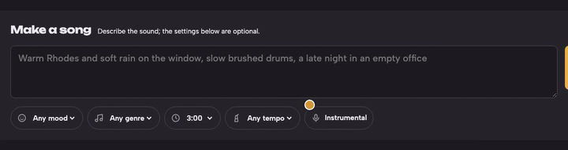

2. Pick a **mood**, a **genre**, a **length** and a **tempo** with the chips under the box, or leave them as they are.

   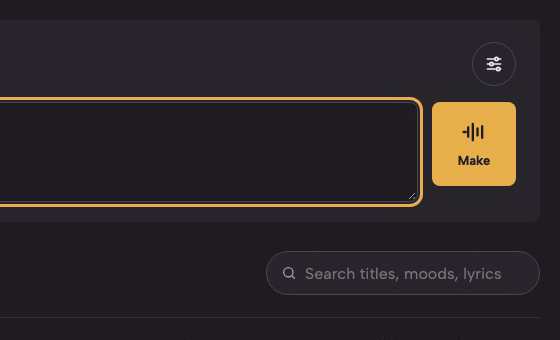

3. For singing, press **Instrumental** so it says **Vocals**. A lyrics box opens: write your own, with `[verse]` and `[chorus]` sections, or leave it empty and they are written for you. Choose the language under **Sung in**.

   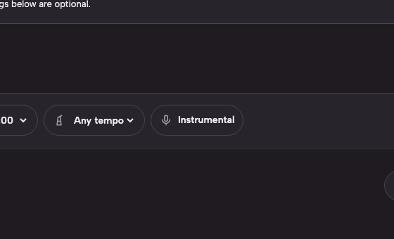

4. Press **Make**. The song shows under **Being made**, with its progress and the time left; press **Cancel** there to stop it.

   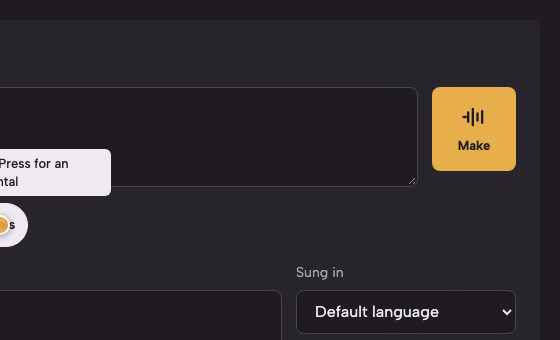

5. When it is done it moves to your songs, with a title. Press its play button to hear it.

   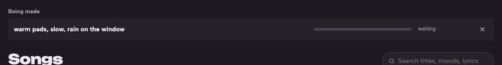

Every Make is a new take, so the same description makes a different song each time. To make one again exactly, see [Make the same song again](#make-the-same-song-again). What happens behind Make is in [arc42 8.2](../architecture/08-crosscutting-concepts.md#82-songs).

## Make the same song again

Every song keeps its seed. Made again with the same settings and the same seed, on the same engine and model, it comes out the same.

1. Press the song's title. Its details open: what it was made from, its lyrics and its downloads.

   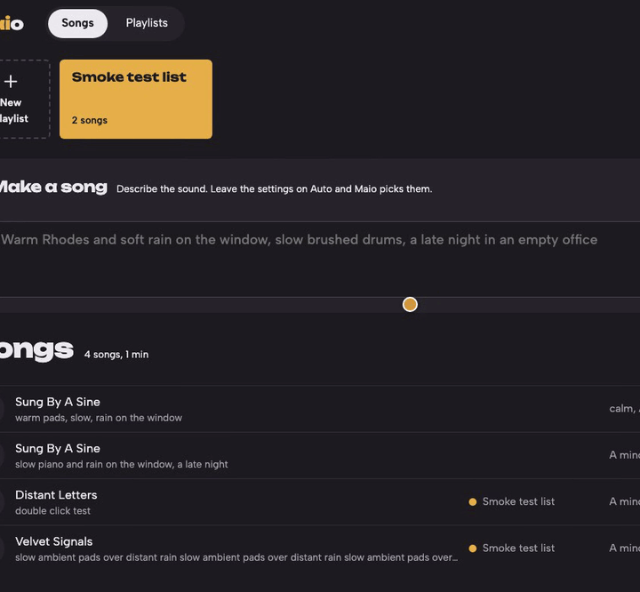

2. Press **Make one like this**. The Make box fills in with the song's description, settings and seed; the seed shows as a chip.

   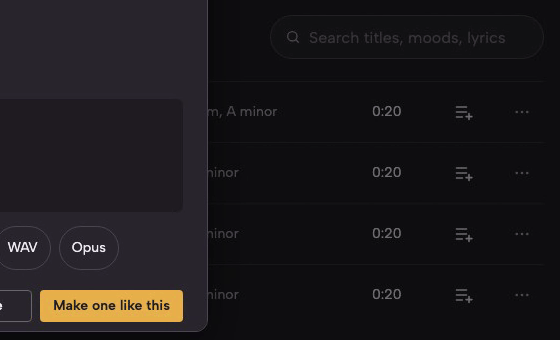

3. Press **Make**.

   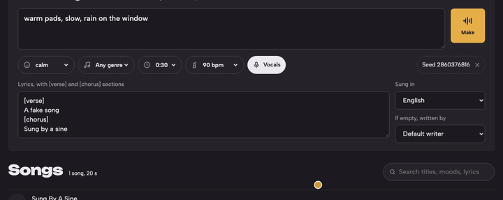

To keep the settings but get a new take, remove the seed chip with its × before pressing Make. Change the description or a setting and the song changes too. What a song keeps is in [arc42 8.2](../architecture/08-crosscutting-concepts.md#82-songs).

## Find, play and download a song

1. Type in **Search songs**, above the list. It looks in titles, moods and lyrics, and says how many songs it found.

   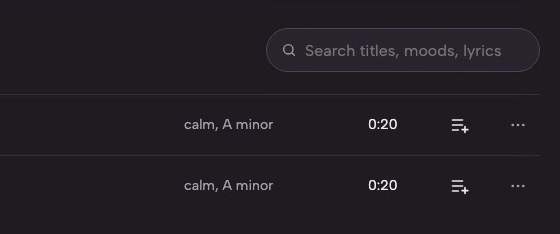

2. Press a song's play button. The player bar opens at the bottom of every screen.

   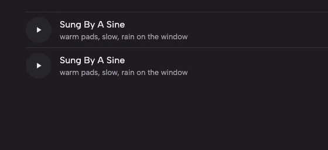

3. Use the player bar: shuffle, previous, play and pause, next, **repeat** (off, all, or this song), the seek bar and the volume.

   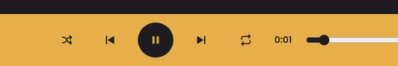

4. To download it, press the song's title and choose a format under **Download**: MP3, AAC, FLAC, WAV or Opus. The file is named after the song and carries its tags.

   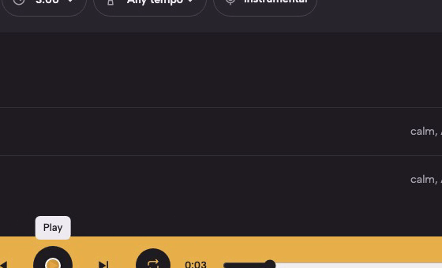

How playlists play in the player is in [arc42 8.3](../architecture/08-crosscutting-concepts.md#83-playlists-and-the-player).

## Rename or delete a song

1. Press the **⋯** button at the end of the song's row. It opens **Details**, **Rename** and **Delete**.

   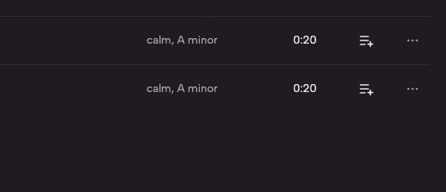

2. Choose **Rename**, type the new title and press **Rename**. The new title shows everywhere at once, on every open page, and it is written into the song's file.

   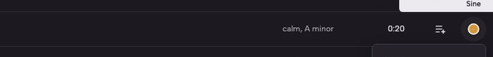

**Delete** asks first, then deletes the song and its file; this cannot be undone. A song in a playlist cannot be deleted: Maio says which playlists hold it, so remove it from them first. The rules are in [arc42 8.2](../architecture/08-crosscutting-concepts.md#82-songs).

## Make a playlist and add songs

1. On the shelf above your songs, press **+**, name the playlist and press **Create**. Its page opens.

   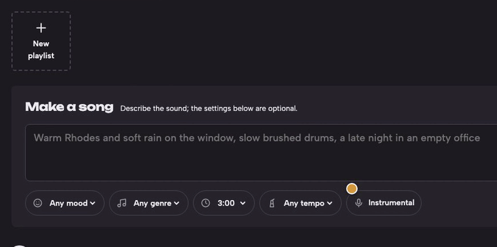

2. From **Songs**: press a song's add-to-playlist button and pick the playlist.

   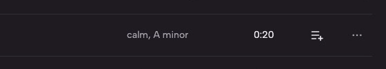

3. From the playlist's page: press **+** on its band, search, tick the songs you want and press **Add**. Only songs not yet in the playlist are offered; they go at the end.

   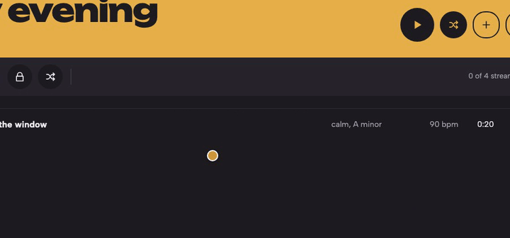

4. To change the order, drag a song by its handle, or select the handle and use the arrow keys. **−** at the end of a row takes a song out of the playlist; it stays in your songs.

   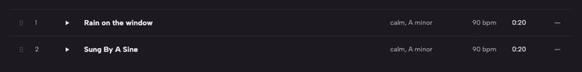

The band's other buttons play the playlist, play it shuffled, and rename or delete it; deleting a playlist keeps its songs. How playlists work is in [arc42 8.3](../architecture/08-crosscutting-concepts.md#83-playlists-and-the-player).

## Stream a playlist

1. Open the playlist and turn on **Live** in the strip under its band. It plays on the server, for every listener at the same moment.

   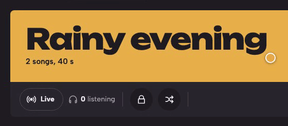

2. Copy an address with its copy button: MP3, AAC or HLS for browsers and players such as VLC. **Public** or **Private** in the strip decides who can find it, and **New link** stops a private link's old address.

   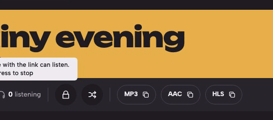

3. Turn **Live** off to stop: every listener is disconnected.

   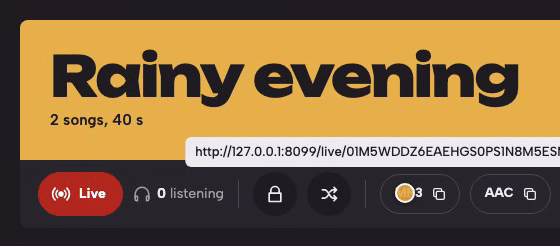

RTSP, SRT and RTMP addresses, the address listeners see, and the limit on live playlists are in [Go live and share a stream](03-go-live-and-share-a-stream.md).

## Check the engine

1. Look at the chip icon in the header: a green dot means a song can be made now. Hover it, or focus it, for its state. Press it for the engine panel.

   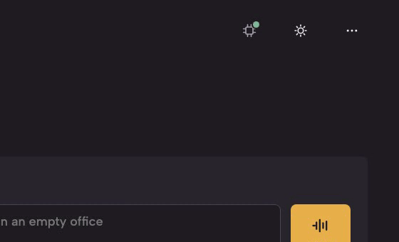

The panel shows each engine's state and what to do about it:

| It says | What to do |
|---|---|
| Ready to make songs. | Nothing. |
| Started, and loading its model | Wait a minute or two. |
| Checking whether it answers. | Wait a moment. |
| Not answering. | Start its server, and check its address in the configuration file ([Run ACE-Step for Maio](01-run-ace-step-for-maio.md)). |

It also shows the engine's version, model, lyrics model, queue, song lengths, voice, speed and licence, and a **Model** switch when more than one model is installed. When MediaMTX is set up, a second icon beside it opens MediaMTX's panel in the same way. Why and how often the engine is checked is in [arc42 8.8](../architecture/08-crosscutting-concepts.md#88-when-the-engine-is-busy-or-down).

## Change your password, sign out or switch the theme

1. The moon or sun in the header switches between the dark and the light theme. Your browser remembers it.

   

2. The **⋯** button at the right of the header opens **Change password** and **Sign out**. Change password asks for the current password and the new one twice, 10 to 128 characters.

   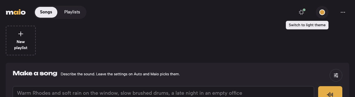

Signing in, sessions and passwords are in [arc42 8.1](../architecture/08-crosscutting-concepts.md#81-signing-in-and-security).
