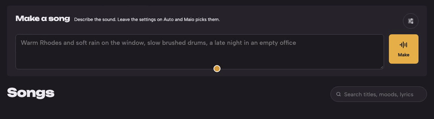
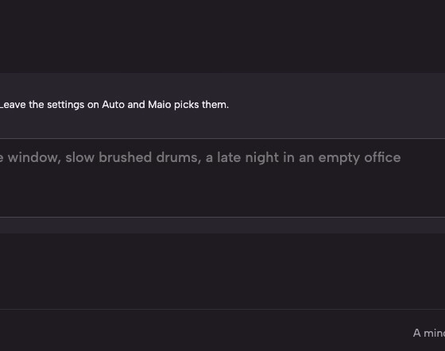
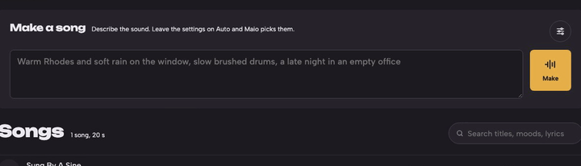
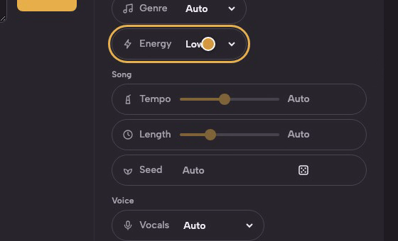
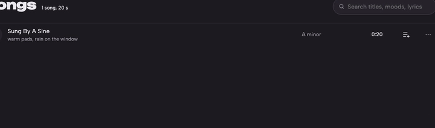
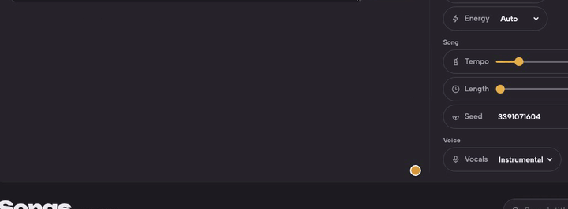
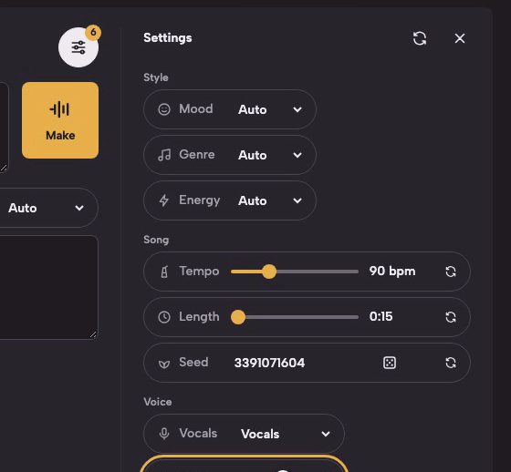

# Shape a song with the settings

In about twenty minutes you make a song with every setting on Auto, then take control of it one setting at a time: its mood and energy, its tempo and length, a take you want to keep, and a voice. You need Maio running ([Quick start](../../README.md#quick-start)) and an engine that is ready: the chip icon in the header shows a green dot. If you have never made a song, start with [Your first song, on air](01-your-first-song-on-air.md).

## Make one on Auto

1. On **Songs**, describe the song in **What it sounds like**, for example *warm pads, rain on the window*, and press **Make**. Leave the settings alone: everything starts on Auto, so Maio picks the length and whether it is sung, and ACE-Step picks the tempo.

   

2. When the song is done, press its title. Its details open. **Sent to the engine** is the exact text ACE-Step received: your words, with the settings Maio added as words. With everything on Auto, there are few of them. **Length** shows how long it came out, from the length Maio picked.

   

Close the details.

## Choose a mood and an energy

1. Press the settings button beside **Make a song**. The settings open beside the description, in three groups: Style, Song and Voice.
2. Set **Mood** to *calm* and **Energy** to *low*. The button now counts 2.
3. Look at the empty description box: its grey text shows what these settings alone add to what the engine gets, *calm mood, low energy*. Mood, genre and energy go to the engine as words: it usually follows them, but not always.

   

## Set the tempo and the length

1. Drag the **Tempo** slider. It wakes up from Auto and shows the tempo beside it, *96 bpm*: the engine gets it both as words and as a number it follows.
2. Drag the **Length** slider the same way. The length is followed exactly.
3. Press ↺ at the end of a slider to give that setting back to Auto.

   

Make a song now and compare it with your first one: same description, a different song.

## Keep a take, and make a variation

Every song keeps the number it started from, its seed. Same settings and same seed, on the same engine and model, make the same song again.

1. Press the title of a song you like, then **Make one like this**. The settings fill in with that song's, and **Seed** shows its seed.

   

2. Change one setting, say **Energy** to *medium*, and press **Make**. The new song is a variation of the one you liked.
3. For a new take with the same settings instead, press ↺ beside **Seed**: it goes back to Auto, a new seed each time. 🎲 picks a random seed you can see and keep.

## Add a voice

1. Set **Vocals** to *Vocals*. **Voice** and **Sung in** appear in the settings, and a lyrics box opens under the description.
2. Set **Voice** to *Female*. It reaches the engine as *female vocals*: a hint it usually follows.
3. Leave the lyrics box empty and they are written for you, by the writer under **Lyrics by**; or write your own with `[verse]` and `[chorus]` sections.

   

## Back to Auto

1. Press the ↺ in the settings' header, **Put every setting back on Auto**. Every setting goes back to Auto; your description and lyrics stay.

   

## What next

- [The settings, one by one](../architecture/08-crosscutting-concepts.md#the-settings-one-by-one): every setting's values, what Auto does for it, and exactly what the engine gets.
- [Make the same song again](../how-to/07-use-the-web-app.md#make-the-same-song-again), in the guide to the web app.
- [Add a text engine](../how-to/02-add-a-text-engine.md), so a language model writes the lyrics and titles.
